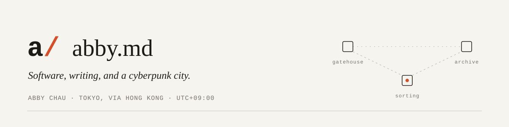

<a href="https://abby.md">
  <picture>
    <source media="(prefers-color-scheme: dark)" srcset="assets/banner-dark.svg">
    
  </picture>
</a>

Software engineer in Tokyo, via Hong Kong. I've worked on payment infrastructure, financial systems, distributed storage and mobile apps. I like the lower layers (databases, queues, language runtimes) and making them useful to people. Rust and Go, often. Basketball and music. Always another idea.

**[abby.md](https://abby.md)** · [Field notes](https://ghost.abby.md) · [LinkedIn](https://www.linkedin.com/in/zkizabby/) · [Plurk](https://www.plurk.com/abbychau) · [Instagram](https://www.instagram.com/abbychau2000/)

### Selected work

| | Project | Stack | What it is |
|:-:|---|---|---|
| 01 | **[GTSDB](https://github.com/abbychau/gtsdb)** · [site](https://gtsdb.abby.md/) | Go | Time-series database where the write-ahead log *is* the storage engine. Built for IoT and the edge. |
| 02 | **[Diesel CLI Ext](https://github.com/abbychau/diesel_cli_ext)** | Rust | Generates Rust models and Protocol Buffers from your database schema. |
| 03 | **[MultiQueue2](https://github.com/abbychau/multiqueue2)** | Rust | Maintained MultiQueue fork: bounded MPMC queues, broadcast, async. |
| 04 | **[MIST](https://github.com/abbychau/mist)** · [site](https://mist.abby.md/) | Go | In-memory SQL engine with MySQL-compatible syntax. Handy for CI tests; runs in WASM. |
| 05 | **[simd-cmp](https://github.com/abbychau/simd-cmp)** | Rust | `cmp`, but with portable SIMD. About 4× faster (nightly). |
| 06 | **[RingZero](https://github.com/abbychau/ringzero)** · [site](https://ringzero.abby.md/) | Node.js | Terminal coding-agent harness with a zero-dependency kernel and context compaction. |

### Lately

- **[mpmc-std](https://github.com/abbychau/mpmc-std)**: single-file, disruptor-style async MPMC queue built on hand-picked memory orderings (Rust)
- **[AbbyEVM & AbbyScript](https://github.com/abbychau/abbyevm)**: a small EVM with a JavaScript-like language (Rust)
- **[Oxiphant](https://github.com/abbychau/Oxiphant)** & **[ferricc](https://github.com/abbychau/ferricc)**: tiny compilers for a PHP subset and for C, emitting x86-64 (Rust)
- **[AbbyTerm](https://github.com/abbychau/abbyterm)**: a decent terminal emulator for Linux

### Outside the usual stack

- **[Undisclosed Cyberpunk City](https://cyberpunk.abby.md/)**: an ongoing game. The dev archive lives here.
- **[RHY26](https://abbychau.itch.io/rhy26)**: a 26-key rhythm game with real-time MOD decoding (Godot, C#), plus a [chart recorder](https://github.com/abbychau/rhy26-web)

<b>More projects</b>

- **Infra & backend**: [GTSDB Admin](https://github.com/abbychau/gtsdb-admin) · [Queue Mounts](https://github.com/abbychau/queue-mounts) · [GTSmail](https://github.com/abbychau/gtsmail) · [usize-kv](https://github.com/abbychau/usize-kv) · [Vertriqe](https://github.com/abbychau/vertriqe-smartcontract)
- **Dev tools**: [PM2 Admin](https://github.com/abbychau/pm2-admin) · [Interphase](https://github.com/abbychau/interphase) · [Redis Admin](https://github.com/abbychau/RedisAdmin) · [CPU Affinity Benchmark](https://github.com/abbychau/cpu-process-affinity)
- **Apps & UI**: [AbbyMusic](https://github.com/abbychau/AbbyMusic) · [Forum Browser](https://github.com/abbychau/ForumBrowser) · [Tiny HTML Editor](https://github.com/abbychau/tiny-html-editor) · [ND1P Launcher](https://github.com/abbychau/No-Drawer-One-Page-Launcher) · [Svelma](https://github.com/c0bra/svelma) · [Smiecha](https://github.com/abbychau/smiecha)
- **Play**: [BMS-Dropper](https://github.com/abbychau/BMS-Dropper) · [joy2mouse](https://github.com/abbychau/joy2mouse)

More on [abby.md](https://abby.md) · [old archives](https://blog.abby.md/_meta/index.htm)
